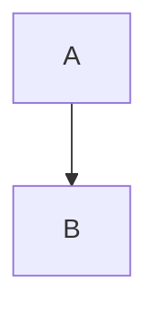

# Markdown in Jasper

Jasper renders comments, wiki pages and other text with
[GitHub Flavored Markdown](https://github.github.com/gfm/) (via [marked](https://marked.js.org/)).
Everything in the [Markdown cheat sheet](https://www.markdownguide.org/cheat-sheet/) works,
including tables, task lists, strikethrough and fenced code blocks.

On top of that, Jasper adds its own syntax for tags, users, wikis and embeds.

## Tags

Write a hashtag to link to a tag page:

```markdown
Read more in #science or #people/murray.
```

- Tags follow the Jasper tag format: lowercase letters and numbers, separated by `/` or `.`.
  Protected (`#+tag`) and private (`#_tag`) tags work too.
- Plain numbers such as `#1` are not linked.
- Add a query string to open the tag page with options, for example
  `#science?view=list` or `#science?sort=published`.
- When editing, hashtags are also added to the Ref's tags by default. You can remove them before saving.

## Users

Mention a user with their user tag:

```markdown
Thanks +user/alice and _user/bob@other!
```

- `+user/...`, `_user/...`, `+plugin/...` and `_plugin/...` become links to the tag page.
- Users without an origin are linked in the origin of the Ref being viewed.
- When editing, mentioning a user also adds their inbox tag by default, which notifies them.

## Wiki links

Link to a wiki page with double brackets:

```markdown
See [[Double bracket]] for details.
```

The text is converted into a wiki URL: whitespace becomes `_`, the first letter is capitalized
and the rest is lowercased. So `[[double bracket]]` links to `wiki:Double_bracket`.
The `wiki:` prefix can be changed in the Wiki config. If the wiki is external, the link opens the
external site instead.

`[[1]]` and `[[alt1]]` are not wiki links, so they can be used with reference style links:

```markdown
As reported^[[1]].

[1]: https://example.com/source
```

## Embeds

Jasper can embed Refs, query results and media directly in the page.
Any URL may be used, including Jasper Refs (`/ref/...`) and tag queries (`/tag/...` or `tag:/...`).

| Syntax                     | Result                                                                    |
|----------------------------|---------------------------------------------------------------------------|
| ``                 | Embed the content of the URL. Refs show their comment and plugin embeds.  |
| ``      | A normal image.                                                           |
| `![[Page title]]`          | Embed a wiki page, same as `` for a wiki link.                       |
| ``                | Embed the Ref itself inline, with its title, tags and actions.            |
| ``                | A ＋ toggle button that shows or hides the embed.                          |
| `[text](url)`              | A link. If the URL can be embedded, a ＋ toggle is added after the link.  |

For example:

```markdown


```

- Embedding a tag query shows the query results. Use the query string to choose a
  `view`, `filter`, `search` or `sort`.
- URLs handled by an enabled plugin (images, videos, audio, YouTube, ...) are embedded with that plugin.
- Other web URLs are embedded with [oEmbed](https://oembed.com/) when possible.
- If the image plugin is disabled, images are shown as links instead.

## Superscript

Use a caret for superscript:

```markdown
E = mc^2 and a footnote^[[1]]
```

## Math

When the **LaTeX** plugin (`plugin/latex`) is on the Ref, math is rendered with
[KaTeX](https://katex.org/docs/supported.html):

```markdown
Inline math $f(x) = x^2$ and block math:

$$\int_{-\infty}^{\infty} e^{-x^2} dx = \sqrt{\pi}$$
```

Without the plugin, dollar signs are left as plain text.

## Code

Fenced code blocks are syntax highlighted with [Prism](https://prismjs.com/).
Add the language after the opening fence:

````markdown
```typescript
const answer = 42;
```
````

Code blocks also have a copy button.

## Diagrams

Fenced code blocks with the `mermaid` language are drawn as [Mermaid](https://mermaid.js.org/) diagrams:

````markdown

````

In some places, such as previews, the diagram is not drawn until you press the render button.

## Tables

When the **Table** plugin (`plugin/table`) is on the Ref, the comment is read as CSV and shown as a table.
Otherwise, use the normal Markdown table syntax.

## HTML

Inline HTML is allowed, but it is sanitized: scripts, `<style>` tags and unsafe URLs are removed,
and inline styles are limited to basic formatting such as color, font, size, margin and borders.
Images, video and audio are loaded through Jasper's embeds, just like Markdown images.
