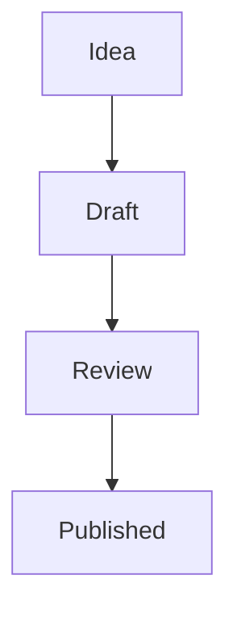

# Writing in Jasper

When you write a comment, a wiki page or any other text in Jasper, you can format it with
**Markdown**. Markdown is plain text with a few symbols that change how it looks. You don't
need any special buttons: type the symbols and Jasper does the rest.

If you never use any of these symbols, that's fine too. Plain text always works.

Each section below shows what to type, and then describes what you get.

## Paragraphs and line breaks

Leave an empty line between paragraphs:

~~~markdown
This is the first paragraph.

This is the second paragraph.
~~~

A single line break without an empty line is joined into the same paragraph.
To force a new line, end the line with two spaces or a backslash (`\`).

## Bold, italic and strikethrough

~~~markdown
*italic* or _italic_
**bold** or __bold__
***bold and italic***
~~strikethrough~~
~~~

## Headings

Start a line with `#` followed by a space. More `#` signs make a smaller heading:

~~~markdown
# Big heading
## Smaller heading
### Even smaller heading
~~~

## Links

Put the text in square brackets, and the address right after it in round brackets:

~~~markdown
[Visit the example site](https://example.com)
~~~

You can also just paste an address such as `https://example.com`, and it becomes a link.

## Images

Images look like links with an exclamation mark in front. The text in square brackets
describes the image for people who can't see it:

~~~markdown

~~~

## Lists

Start each line with `-` (or `*`) for bullet points, or with a number and a period for a numbered list.
Indent a line to put it inside the item above it:

~~~markdown
- Apples
- Oranges
  - Blood oranges
- Pears

1. First step
2. Second step
3. Third step
~~~

Add `[ ]` or `[x]` after the dash to make a checklist:

~~~markdown
- [x] Buy milk
- [ ] Call the bank
~~~

## Quotes

Start a line with `>` to quote someone:

~~~markdown
> The best way to predict the future is to invent it.
~~~

## Horizontal line

Three dashes on their own line draw a line across the page:

~~~markdown
---
~~~

## Code

Wrap a short piece of code in backticks (`` ` ``) to show it in a fixed-width font: `` `like this` ``.

For longer code, put three backticks on the line before and the line after it.
Write the name of the language after the first three backticks to color the code:

~~~markdown
```javascript
const answer = 42;
```
~~~

Code blocks have a button to copy the code.

## Tables

Separate columns with `|`. The second line of dashes separates the header from the rows:

~~~markdown
| Fruit  | Color  |
|--------|--------|
| Apple  | Red    |
| Banana | Yellow |
~~~

The columns don't have to line up, but it makes the text easier to read.

## Showing a symbol as-is

If you want to show a symbol like `*` or `#` without it changing the formatting, put a
backslash in front of it: `\*not italic\*`.

---

Everything above is standard Markdown. The rest of this page covers features that only Jasper has.

## Tags

Type `#` followed by a tag to link to that tag's page:

~~~markdown
Read more in #science or #people/murray.
~~~

- Tags use lowercase letters and numbers. Use `/` or `.` to make sub-tags, like `#people/murray`.
- Protected tags start with `+` (`#+news`) and private tags start with `_` (`#_notes`).
- Plain numbers such as `#1` are left alone.
- To open the tag page with options, add them after a `?`. For example, `#science?sort=published`.
- When you save, hashtags you used are also added to your post's tags. You can remove them before saving.

## Mentioning users

Type a user's tag to mention them:

~~~markdown
Thanks +user/alice and _user/bob!
~~~

- This links to the user's page.
- When you save, the user is notified. You can remove the notification before saving.
- To mention someone on another server, add `@` and the server name: `+user/bob@other`.

## Wiki links

Put a page title in double square brackets to link to a wiki page:

~~~markdown
See [[Double bracket]] for details.
~~~

Spaces become underscores, the first letter becomes uppercase and the rest becomes lowercase.
So `[[double bracket]]` and `[[Double Bracket]]` both link to the same page.

Numbers in double brackets, like `[[1]]`, are not wiki links. This lets you use them as footnotes:

~~~markdown
The sky is blue.^[[1]]

[1]: https://example.com/why-is-the-sky-blue
~~~

## Superscript

Put `^` in front of text to raise it up:

~~~markdown
E = mc^2
~~~

## Embedding

Embedding shows something from another page right inside your text, such as a video,
another post or a list of posts.

Use the image format with an empty description, ``, and put the address in the round brackets:

~~~markdown

~~~

The address can be:

- **Any web address.** Videos, sound and pictures are played or shown in place.
  Many other sites, like video sites, also show a preview.
- **A post in Jasper.** Its text and media are shown.
- **A tag page.** The latest posts with that tag are listed. Use `/tag/` and the tag, for example
  ``. You can add options after a `?`, like ``.

There are a few other ways to embed:

- `![[Page title]]` embeds a wiki page.
- `` shows a post as a small card, with its title, tags and buttons.
- `` shows a ＋ button. Press it to show the embed, and press ✕ to hide it again.

Normal links to things that can be embedded also get a ＋ button after them.

## Math

If your post has the **LaTeX** tag (`plugin/latex`), you can write math formulas. Put a formula
between single dollar signs to keep it in the line of text, or double dollar signs to show it on its own line:

~~~markdown
The area of a circle is $\pi r^2$.

$$x = \frac{-b \pm \sqrt{b^2 - 4ac}}{2a}$$
~~~

Some common commands:

- `x^2` for powers and `x_1` for subscripts. Use curly brackets for more than one character: `x^{10}`.
- `\frac{a}{b}` for fractions and `\sqrt{x}` for square roots.
- `\alpha`, `\beta`, `\pi` and so on for Greek letters.
- `\sum`, `\int`, `\infty`, `\le`, `\ge` and `\ne` for sums, integrals, infinity, ≤, ≥ and ≠.

Without the LaTeX tag, dollar signs are shown as normal text.

## Diagrams

Write `mermaid` as the language of a code block to draw a diagram.
Each line connects two boxes with an arrow:

~~~markdown

~~~

`graph TB` draws from top to bottom. Use `graph LR` to draw from left to right.
In some places, such as previews, you press a button to draw the diagram.

## Spreadsheets

If your post has the **Table** tag (`plugin/table`), write the text as comma separated values
and it is shown as a table:

~~~markdown
Fruit,Color
Apple,Red
Banana,Yellow
~~~

## HTML

If you know HTML, you can use it too. For safety, scripts and anything that could change the rest
of the page are removed, and pictures, video and sound are shown the same way as Markdown images.
